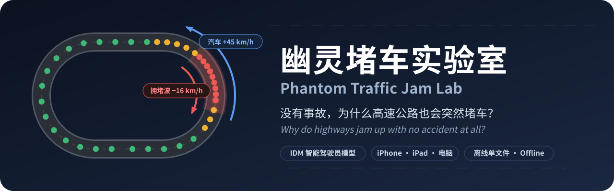
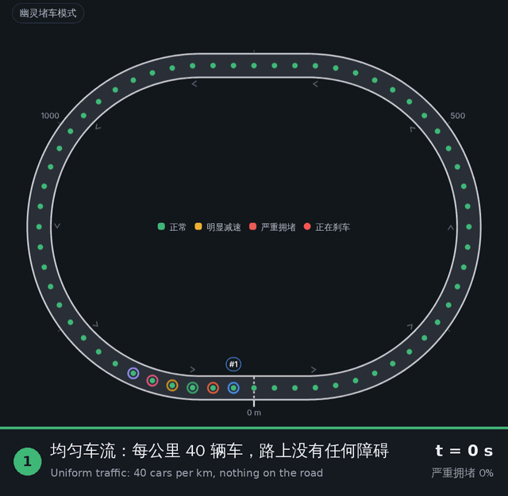
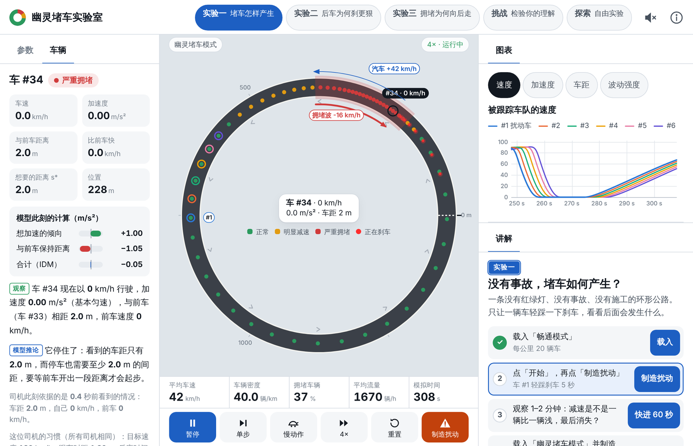
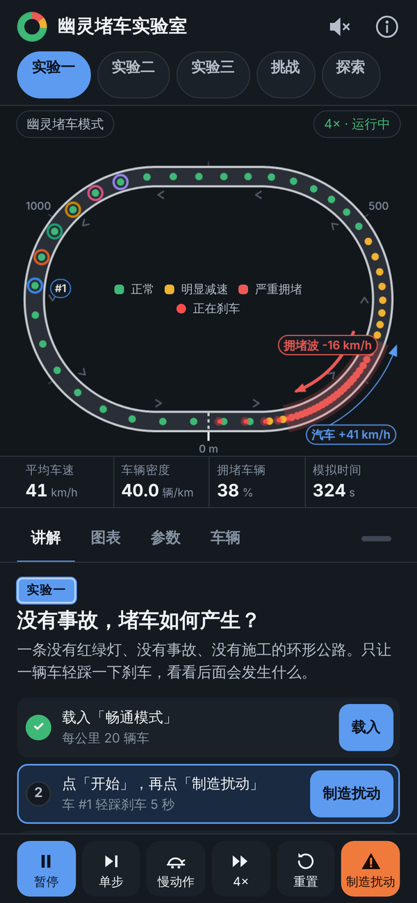
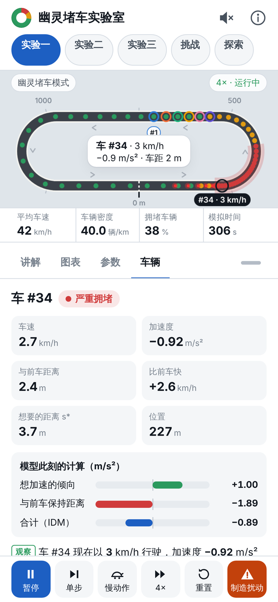
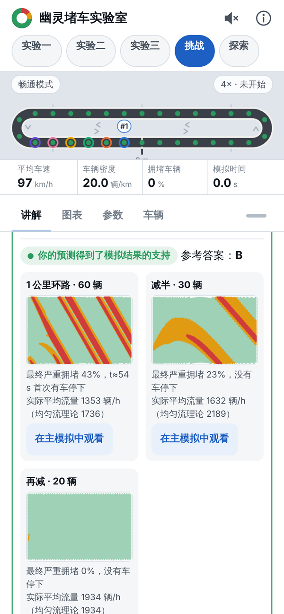
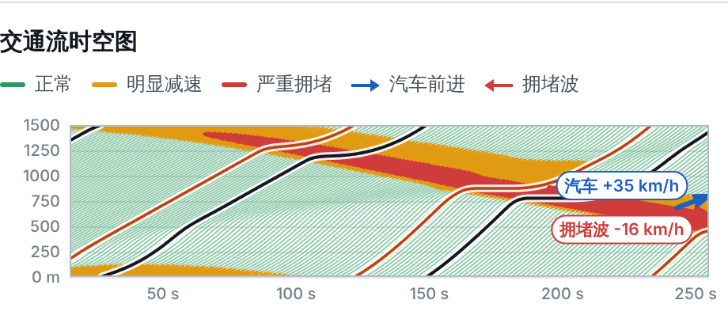

<div align="center">



<br>

<a href="https://kkaa777.github.io/phantom-traffic-lab/"></a>
&nbsp;
<a href="https://github.com/KKAA777/phantom-traffic-lab/archive/refs/heads/main.zip"></a>


<h3>没有红绿灯、没有事故、没有施工——为什么车流会自己停下来？</h3>
<p><i>No traffic lights, no accident, no roadworks — so why does traffic stop all by itself?</i></p>



<sub>真实模拟录屏：一次轻踩刹车，约 2 分钟后长成走走停停、并且向后移动的拥堵波<br>
<i>Recorded from the live simulation: one gentle tap on the brakes grows into a stop-and-go wave that travels backwards</i></sub>

<br><br>

<a href="#what">🚗 这是什么 · What</a> &nbsp;·&nbsp;
<a href="#features">✨ 功能 · Features</a> &nbsp;·&nbsp;
<a href="#screenshots">📸 截图 · Screenshots</a> &nbsp;·&nbsp;
<a href="#experiments">🧪 实验 · Experiments</a> &nbsp;·&nbsp;
<a href="#how">🕹️ 用法 · How to use</a> &nbsp;·&nbsp;
<a href="#run">📱 运行 · Run it</a> &nbsp;·&nbsp;
<a href="#model">🔬 模型 · Model</a>

</div>

<br>

<a id="what"></a>

## 🚗 这是什么？ · What is this?

<b>幽灵堵车</b>（phantom traffic jam）是指：路上没有事故、没有施工、也没有车道减少，车流却自己出现走走停停。2008 年，日本的研究者让 22 辆车在一条周长 230 米的环形跑道上匀速行驶，没过多久，车队里就“凭空”出现了一段堵车（Sugiyama 等，<i>New J. Phys.</i> 2008）。

这个交互式物理实验室把同样的实验搬进了浏览器：一条单车道环形公路，路上没有任何障碍，每辆车都由<b>智能驾驶员模型</b>（IDM）独立驾驶——它只看三样东西：与前车的距离、自己的速度、比前车快多少。你可以亲手让一辆车轻踩一下刹车，然后看着这个小小的扰动一辆车一辆车地被放大，最后变成一个<b>向后移动</b>的拥堵波，而每一辆车始终在<b>向前</b>开。

A **phantom traffic jam** is stop-and-go traffic with no accident, no roadworks and no lane closure. In 2008, researchers in Japan had 22 cars drive steadily around a circular track 230 m long — and before long a jam appeared out of nowhere (Sugiyama et al., *New J. Phys.* 2008).

This interactive physics lab brings that experiment into your browser: a single-lane ring road with nothing on it, where every car is driven independently by the **Intelligent Driver Model (IDM)**. Each driver looks at only three things: the gap to the car ahead, its own speed, and how fast it is closing in. Tap the brakes of one car — gently — and watch the disturbance grow from car to car until it becomes a jam that travels **backwards**, while every single car keeps driving **forwards**.

> [!NOTE]
> 画面、图表和讲解里的每一个数字都来自同一个实时运行的模型，没有任何预先画好的动画。<br>
> Everything you see — the animation, the charts and every number in the explanations — comes from the same live simulation. Nothing is pre-drawn.

<a id="features"></a>

## ✨ 功能一览 · Features

| | 中文 | English |
|:-:|---|---|
| 🛣️ | 单车道环形公路，10–90 辆车；每辆车都有自己的位置、速度、加速度和驾驶习惯 | Single-lane ring road with 10–90 cars, each with its own position, speed, acceleration and driving habits |
| ⏱️ | 真实的反应时间：司机依据 τ 秒前看到的情况做决定 | Real reaction time: drivers act on what they saw τ seconds ago |
| 👆 | 轻点任意一辆车，看它的速度、车距，以及模型此刻<b>为什么</b>让它刹车 | Tap any car to see its speed, its gap and **why** the model makes it brake right now |
| 📈 | 实时图表：速度、加速度、车距、波动强度、时空图，按住即可读数 | Live charts — speed, acceleration, gap, wave strength, space-time diagram — touch and hold to read values |
| 🧪 | 三个循序渐进的实验，每个都有「发生了什么 → 为什么 → 证据 → 改变条件」四层讲解 | Three guided experiments, each explained in four layers: what happened → why → evidence → what if |
| 🎯 | 五道“先预测、再验证”的挑战，答案由模型现场计算 | Five predict-then-verify challenges, answered by actually running the model |
| 🎛️ | 5 个预设、11 个可调参数、慢动作、单步、0.5×–16× 倍速 | 5 presets, 11 adjustable parameters, slow motion, single steps, 0.5×–16× speed |
| 🔊 | 可选声音：随车速变化的行驶声，堵车时远处断断续续的鸣笛 | Optional sound: driving noise that follows the traffic, distant on-and-off honking in jams |
| 📱 | 为 iPhone / iPad 设计：竖屏、横屏、分屏都能用，全部触控操作 | Made for iPhone & iPad: portrait, landscape and Split View, everything by touch |
| 🌗 | 浅色 / 深色模式 | Light & dark mode |
| 📦 | 整个实验室只是一个 HTML 文件：零依赖，离线可用 | The whole lab is a single HTML file: zero dependencies, works offline |

<a id="screenshots"></a>

## 📸 截图 · Screenshots

<p align="center">
  
  <br>
  <sub>iPad 横屏：左边是被选中的车“为什么停下”，中间是环路和拥堵波，右边是图表和讲解<br>
  <i>iPad landscape — left: why the selected car has stopped · centre: the ring road and the jam wave · right: charts and lessons</i></sub>
</p>

<table>
  <tr>
    <td align="center" width="33%"><br><sub>深色模式下的幽灵堵车<br><i>A phantom jam in dark mode</i></sub></td>
    <td align="center" width="33%"><br><sub>轻点一辆车：模型此刻的计算<br><i>Tap a car: what the model is computing</i></sub></td>
    <td align="center" width="33%"><br><sub>挑战：先预测，再用模型验证<br><i>Challenges: predict, then verify</i></sub></td>
  </tr>
</table>

<a id="experiments"></a>

## 🧪 三个实验 + 挑战 · Three experiments + challenges

### 1️⃣ 实验一 · 没有事故，堵车如何产生？
**Experiment 1 · How does a jam start without an accident?**

同样的司机、同样的一次轻踩刹车（车 #1 轻刹 5 秒）：每公里 20 辆车时，减速一辆比一辆浅，最后消失；每公里 40 辆车时，约 2 分钟后长成走走停停的拥堵波。最后再对比「临界模式」和「优化模式」。

Same drivers, same gentle tap on the brakes (car #1, for 5 seconds). At 20 cars per km the slowdown gets weaker from car to car and fades away; at 40 cars per km it grows into a stop-and-go wave within about two minutes. Finally, compare the *critical* and the *optimised* modes.

### 2️⃣ 实验二 · 为什么后车可能刹得更狠？
**Experiment 2 · Why do the cars behind brake harder?**

同时跟踪连续 6 辆车（扰动车和它后面的 5 辆）。用慢动作、单步和车队特写盯住：谁先刹车？车距怎样变？每辆车的最低速度是不是一个比一个低？然后把反应时间从 0.7 秒改成 0.2 秒再做一次。讲解里的每个数字都来自你这一次的模拟。

Follow six consecutive cars — the one that braked and the five behind it — in slow motion, step by step, with a close-up of the platoon. Who brakes first? How do the gaps change? Does each car's lowest speed drop below the one ahead? Then change the reaction time from 0.7 s to 0.2 s and try again. Every number in the explanation is measured in your own run.

### 3️⃣ 实验三 · 为什么堵车向后走，而汽车向前开？
**Experiment 3 · Why does the jam move backwards while the cars move forwards?**

环路上的箭头和时空图显示：拥堵区以大约 16 km/h 的速度向后移动。挑一辆正驶向拥堵的车，跟踪它进入、穿过、离开拥堵——在时空图里，它的轨迹一直向上（前进），红色的拥堵带却一直向下（后退）。

Arrows on the road and the space-time diagram show the jammed zone drifting backwards at about 16 km/h. Pick a car heading into the jam and follow it as it enters, crosses and leaves — in the space-time diagram its track keeps climbing (forwards) while the red band keeps sliding down (backwards).

<p align="center">
  
  <br>
  <sub>时空图：横轴是时间，纵轴是道路位置，每条线是一辆车；黑线是被跟踪的那辆车<br>
  <i>Space-time diagram: time runs across, position runs up; each line is one car — the black line is the car being followed</i></sub>
</p>

### 🎯 挑战 · Challenges

先选出你的预测，再让模型在后台真实运行 10–15 分钟的交通来验证，并告诉你答案在什么条件下成立。<br>
Make a prediction, then let the model run 10–15 minutes of real traffic in the background to check it — and learn under which conditions the answer holds.

| # | 问题 | Question |
|:-:|---|---|
| 1 | 车辆数量减少一半，是否一定不会发生幽灵堵车？ | With half as many cars, is a phantom jam impossible? |
| 2 | 所有司机都尽量紧跟前车，是否一定能提高通行能力？ | If every driver follows closely, does the road always carry more cars? |
| 3 | 为什么前方已经恢复畅通，后面仍然可能堵车？ | Why can traffic behind still be jammed when the road ahead is already clear? |
| 4 | 为什么一次突然刹车不一定造成持续拥堵？ | Why doesn't one sudden brake always cause a lasting jam? |
| 5 | 更平稳的加减速、更合理的跟车，怎样影响交通流的稳定性？ | How do smoother driving and sensible following distances affect stability? |

<a id="how"></a>

## 🕹️ 怎么用 · How to use

<b>🚀 最快的开始方式 · Quick start</b>

1. 打开页面，点「实验一」，按讲解里的步骤清单逐个点按钮。<br>
   Open the page, choose <b>实验一 (Experiment 1)</b> and tap the buttons in the step-by-step checklist.
2. 点「开始」，再点「制造扰动」，看一辆车轻踩刹车之后会发生什么。<br>
   Tap <b>开始 (Start)</b>, then <b>制造扰动 (Disturb)</b>, and watch what one gentle brake does.
3. 点「暂停」：页面会用一句话解释此刻正在发生什么。<br>
   Tap <b>暂停 (Pause)</b> — the page explains in one sentence what is happening right now.
4. 轻点环路上的任意一辆车，再打开「车辆」面板。<br>
   Tap any car on the road, then open the <b>车辆 (Car)</b> panel.

<b>🎮 控制条 · Control bar</b>

| 按钮 · Button | 作用 | What it does |
|---|---|---|
| ▶️ 开始 / 暂停 / 继续 · Start / Pause / Resume | 运行或暂停模拟；暂停时解释当前状态 | Run or pause the simulation; pausing explains what is going on |
| ⏭️ 单步 · Step | 前进 0.5 秒 | Advance by 0.5 s |
| 🐢 慢动作 · Slow motion | 0.25 倍速 | 0.25× speed |
| ⏩ 倍速 · Speed | 0.5× / 1× / 2× / 4× / 8× / 16× | 0.5× up to 16× |
| 🔄 重置 · Reset | 回到均匀车流 | Back to uniform traffic |
| ⚠️ 制造扰动 · Disturb | 让一辆车按设定刹车（强度、时长可调） | One car brakes (strength and duration adjustable) |

<b>🧰 其他操作 · More</b>

- 👆 <b>轻点车辆 · Tap a car</b> —— 查看速度、加速度、车距和模型的计算 · see its speed, acceleration, gap and the model's calculation
- 📈 <b>图表 · Charts</b> —— 按住或拖动即可读数 · touch and hold or drag to read values
- 🎛️ <b>参数 · Parameters</b> —— 预设、滑块和 ＋/− 按钮 · presets, sliders and +/− buttons
- 🔊 <b>右上角喇叭 · Speaker (top right)</b> —— 开关声音 · sound on or off
- ⓘ <b>模型说明 · Model notes</b> —— 完整公式、参数和参考文献 · full formulas, parameters and references

<b>🚦 预设 · Presets</b>

| 预设 · Preset | 车辆 · Cars | 每公里 · Per km | 反应时间 · Reaction | 会发生什么 · What happens |
|---|:-:|:-:|:-:|---|
| 🟢 畅通模式 · Free flow | 30 | 20 | 0.4 s | 扰动逐渐被吸收 · the disturbance dies out |
| 🟡 临界模式 · Critical | 36 | 24 | 0.4 s | 小扰动被吸收，大扰动留下拥堵 · small taps fade, big ones leave a jam |
| 🔴 幽灵堵车模式 · Phantom jam | 60 | 40 | 0.4 s | 约 2 分钟后走走停停 · stop-and-go after about two minutes |
| 🔵 优化模式 · Optimised | 60 | 40 | 0.2 s | 车一样多，却不再堵：反应更快、提前轻柔减速 · same traffic, no jam: quicker reactions, earlier and gentler braking |
| 🟣 反应偏慢的车队 · Slow reactions | 60 | 40 | 0.7 s | 实验二专用 · used in Experiment 2 |

<details>
<summary><b>🎛️ 11 个可调参数 · 11 adjustable parameters</b></summary>
<br>

| 参数 | Parameter | 范围 · Range |
|---|---|---|
| 车辆数量 | Number of cars | 10 – 90 |
| 道路长度 | Road length | 500 – 3000 m |
| 目标速度 | Desired speed | 60 – 150 km/h |
| 跟车时间间隔 | Time headway | 0.5 – 3 s |
| 驾驶员反应时间 | Reaction time | 0 – 1.2 s |
| 最大加速度 | Maximum acceleration | 0.3 – 3 m/s² |
| 舒适减速度 | Comfortable braking | 0.5 – 4 m/s² |
| 司机之间的差异 | Variety between drivers | 0 – 30 % |
| 扰动强度 | Disturbance strength | 0.5 – 8 m/s² |
| 扰动持续时间 | Disturbance duration | 0.5 – 10 s |
| 随机驾驶波动 | Random driving fluctuation | 0 – 0.4 m/s² |

改变车辆数量或道路长度会让模拟重新开始；其他参数立即生效。<br>
Changing the number of cars or the road length restarts the simulation; every other parameter takes effect immediately.

</details>

<b>🎨 读懂画面 · Reading the screen</b>

| 颜色 · Colour | 含义 | Meaning |
|:-:|---|---|
| 🟢 | 正常：速度不低于均匀车流的 88% | Normal: at least 88 % of the uniform-flow speed |
| 🟡 | 明显减速：低于 88% | Clearly slowed: below 88 % |
| 🔴 | 严重拥堵：低于 35%（或低于 9 km/h） | Jammed: below 35 % (or below 9 km/h) |
| 🚨 | 红色尾灯：正在以超过 0.8 m/s² 的减速度刹车 | Red tail light: braking harder than 0.8 m/s² |

讲解里的每句话都带着标签 · Every statement in the lessons carries a label:
<b>观察</b> *Observation* — 本次模拟测得 · measured in this run &nbsp;|&nbsp;
<b>模型推论</b> *Model inference* — 由模型规则推出 · follows from the model's rules &nbsp;|&nbsp;
<b>一般理论</b> *General theory* — 来自交通研究，不是本模拟算出的 · from traffic research, not computed here

<b>🔊 声音 · Sound</b>

- 默认关闭；点右上角的喇叭开启（iPhone / iPad 必须先点一下才会出声）。<br>
  Off by default — tap the speaker at the top right (iPhone and iPad need one tap before any sound can play).
- <b>汽车行驶声一直都有</b>：车越快越响、越尖；拥堵时车慢下来，声音也变低。每辆车经过起点（0 m）的“路边麦克风”都会“呼”地一声。<br>
  **Driving sound, always on**: louder and brighter when traffic is faster, lower in a jam. Every car passing the roadside microphone at 0 m goes *whoosh*.
- <b>堵车时远处断断续续地鸣笛</b>：拥堵车辆达到 3% 并持续 1.5 秒后开始，降到 1% 以下并持续 3 秒后停止；拥堵越严重，鸣笛越频繁。<br>
  **Distant, on-and-off honking in jams**: starts once 3 % of the cars have been jammed for 1.5 s and stops after 3 s below 1 %; the bigger the jam, the more often someone honks.
- 声音由浏览器实时合成，不需要网络，也不影响模拟结果。<br>
  All sound is synthesised live in the browser: no network needed, and it never affects the simulation.

<a id="run"></a>

## 📱 在哪里运行 · Run it anywhere

| 设备 · Device | 方法 · How |
|---|---|
| 📱 **iPhone / iPad** | 用 Safari 打开 <b>[在线版][live]</b>，点「分享」→「添加到主屏幕」，以后像 App 一样打开。<br>Open the **[live demo][live]** in Safari, then *Share → Add to Home Screen* to launch it like an app. |
| 💻 <b>电脑 · Computer</b> | 下载 [`index.html`](index.html)（或 [ZIP][zip]），双击即可在浏览器里离线运行。<br>Download [`index.html`](index.html) (or the [ZIP][zip]) and double-click it — it runs offline in your browser. |
| 🌐 <b>自己托管 · Self-host</b> | 把 `index.html` 放到任何静态网页托管（GitHub Pages、Netlify、Cloudflare Pages……）即可。<br>Put `index.html` on any static web host (GitHub Pages, Netlify, Cloudflare Pages, …). |

> [!TIP]
> iOS「文件」App 的预览不会运行网页程序，只会显示静止的画面——请用 Safari 打开网址。<br>
> The iOS Files app preview doesn't run web pages, so you will only see a still picture there — open the web address in Safari instead.

<a id="model"></a>

## 🔬 背后的模型 · The model inside

每辆车的加速度由智能驾驶员模型（IDM，Treiber、Hennecke、Helbing，2000）给出：<br>
Each car's acceleration comes from the Intelligent Driver Model (IDM; Treiber, Hennecke & Helbing, 2000):

```math
\dot v = a\left[1-\left(\frac{v}{v_0}\right)^{4}-\left(\frac{s^{\ast}}{s}\right)^{2}\right],
\qquad
s^{\ast} = s_0+\max\!\left(0,\; vT+\frac{v\,\Delta v}{2\sqrt{ab}}\right)
```

第一项是“想加速到目标速度”，第二项是“和前车保持距离”：当实际车距 $s$ 小于想要的车距 $s^{\ast}$ 时，第二项占上风，车就减速。<br>
The first term is the wish to reach the desired speed; the second keeps a safe distance. When the actual gap $s$ falls below the desired gap $s^{\ast}$, the second term wins and the car slows down.

| 符号 · Symbol | 含义 | Meaning | 正常司机 · Default |
|:-:|---|---|:-:|
| $v$ | 自己的速度 | own speed | — |
| $s$ | 与前车的车距 | gap to the car ahead | — |
| $\Delta v$ | 比前车快多少 | how much faster than the car ahead | — |
| $v_0$ | 目标速度 | desired speed | 120 km/h |
| $T$ | 跟车时间间隔 | time headway | 1.2 s |
| $a$ | 最大加速度 | maximum acceleration | 1.0 m/s² |
| $b$ | 舒适减速度 | comfortable braking | 3.0 m/s² |
| $s_0$ | 最小停车间距 | minimum gap when stopped | 2 m |
| $\tau$ | 反应时间 | reaction time | 0.4 s |

<details>
<summary><b>➕ 在标准 IDM 之外做的扩展 · Extensions beyond the standard IDM</b></summary>
<br>

- <b>反应时间 τ</b> —— 每辆车保存最近的状态，司机依据 τ 秒前看到的车距和速度做决定（线性插值）。<br>
  **Reaction time τ** — each car keeps its recent history; drivers act on the gap and speeds they saw τ seconds ago (linear interpolation).
- <b>刹车极限 9 m/s²</b> —— 任何情况下都不会超过干燥路面的物理极限。<br>
  **Braking limit of 9 m/s²** — never beyond what tyres can do on a dry road.
- <b>防重叠安全约束</b> —— 两车间距小于 0.5 米时会被拦住，并作为“险情”计数提示；在所有预设中从未触发。<br>
  **Anti-overlap safety net** — a gap below 0.5 m is caught, counted and reported as a near miss; it never triggers in any preset.
- <b>可选随机波动</b> —— 平滑的随机起伏（Ornstein–Uhlenbeck 过程，固定随机种子，可复现）。<br>
  **Optional random fluctuations** — smooth random variation (Ornstein–Uhlenbeck process with a fixed seed, so runs are reproducible).
- <b>可选司机差异</b> —— 每位司机的参数可以围绕平均值随机偏离。<br>
  **Optional driver variety** — each driver's parameters can deviate randomly around the average.
- <b>数值方法</b> —— 固定步长 0.05 秒的弹道式积分；屏幕刷新率不影响结果。<br>
  **Numerics** — ballistic integration with a fixed 0.05 s step; the screen's frame rate never changes the result.
- <b>小扰动理论</b> —— 对均匀车流做线性稳定性分析（包含反应延迟），判断一个小波动会被放大还是被吸收。<br>
  **Small-disturbance theory** — a linear string-stability analysis of uniform flow (including the delay) tells whether a small ripple grows or fades.

</details>

> [!IMPORTANT]
> 这是一个简化模型：单车道、不能变道、没有匝道，默认所有司机相同。IDM 的参数会改变“多少辆车开始堵”之类的具体数字，所以页面上的每个结论都写明了成立的条件。<br>
> This is a simplified model: one lane, no lane changes, no ramps, identical drivers by default. The IDM parameters shift the exact numbers (such as how many cars it takes to jam), so every conclusion on the page states the conditions under which it holds.

<details>
<summary><b>✅ 怎样验证的 · How it was checked</b></summary>
<br>

60 项自动测试全部通过 · All 60 automated tests pass:

- <b>模型 · Model (20)</b> —— IDM 公式与平衡解；环路长度守恒；车速不为负、不倒车；反应延迟恰好为 τ；所有预设（含急刹到停）都没有车辆重叠；畅通模式扰动消散；临界模式“小扰动吸收、大扰动留下拥堵”；幽灵堵车模式约 2 分钟出现走走停停，拥堵波约 −16 km/h；优化模式即使急刹也会恢复；步长减半结果一致；不同帧率下结果逐位相同。<br>
  IDM formula and equilibrium; ring length conserved; no negative speeds or reversing; reaction delay exactly τ; no overlapping cars in any preset, even after an emergency stop; free flow absorbs the disturbance; the critical mode absorbs small taps but keeps a jam after a big one; the phantom mode turns stop-and-go after about 2 minutes with a wave of about −16 km/h; the optimised mode recovers even from hard braking; halving the time step gives the same result; bit-identical results at different frame rates.
- <b>教学内容 · Lessons (8)</b> —— 每句依赖模型的结论都由模型核对；五道挑战的参考答案与实际运行结果一致。<br>
  Every model-dependent statement is checked against the model; the five challenge answers match actual runs.
- <b>声音 · Sound (10)</b> —— 行驶声始终存在；鸣笛只在拥堵时出现，而且不会时有时无；车辆经过麦克风的时间准确；在真实模拟中，幽灵堵车形成之后才鸣笛，畅通模式下从不鸣笛。<br>
  Driving sound always on; honking only in jams and without flicker; accurate pass-by timing; in real runs the horns start only after the phantom jam forms, and never in free flow.
- <b>浏览器 · Browser (22)</b> —— 在 Chromium 中模拟 10 种 iPhone / iPad 屏幕尺寸与触控：没有溢出，所有触控目标 ≥ 44 px，各项功能可用，16 倍速约 60 fps；声音经离线渲染测量（响度、音高、间断性、不削波）。<br>
  Chromium emulating 10 iPhone / iPad screen sizes with touch: no overflow, every touch target ≥ 44 px, every feature works, about 60 fps at 16×; the sound was measured from offline renders (loudness, pitch, intermittency, no clipping).

浏览器测试是在 Chromium 中模拟完成的，不等同于真机上的 Safari；声音做了数值测量，但没有经过人耳试听。<br>
The browser tests ran in Chromium emulating iPhone and iPad, which is not the same as Safari on a real device; the sound was measured numerically, not judged by ear.

</details>

## 📚 参考文献 · References

- M. Treiber, A. Hennecke, D. Helbing. *Congested traffic states in empirical observations and microscopic simulations.* Phys. Rev. E **62**, 1805 (2000).
- M. Treiber, A. Kesting. *Traffic Flow Dynamics: Data, Models and Simulation.* Springer (2013).
- M. Treiber, A. Kesting, D. Helbing. *Delays, inaccuracies and anticipation in microscopic traffic models.* Physica A **360**, 71 (2006).
- Y. Sugiyama et al. *Traffic jams without bottlenecks — experimental evidence for the physical mechanism of the formation of a jam.* New J. Phys. **10**, 033001 (2008).
- M. Treiber, V. Kanagaraj. *Comparing numerical integration schemes for time-continuous car-following models.* Physica A **419**, 183 (2015).

<div align="center">
<br>
<sub>🚗 🚗 🚗 🚙 🚗 &nbsp;·&nbsp; 堵车，有时只是因为一次轻踩刹车。<br>
<i>Sometimes a traffic jam is nothing more than one gentle tap on the brakes.</i></sub>
</div>

[live]: https://kkaa777.github.io/phantom-traffic-lab/
[zip]: https://github.com/KKAA777/phantom-traffic-lab/archive/refs/heads/main.zip
